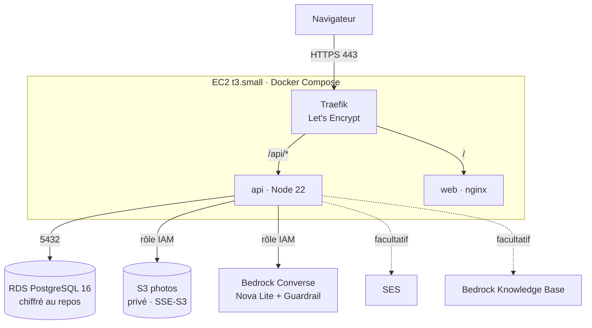

# Déploiement AWS — SmartCampus AI

Guide pas à pas pour déployer le MVP sur AWS (région **us-east-1**) avec le compte du lab : EC2 + Docker Compose (Traefik + API + front), RDS PostgreSQL, S3, Bedrock. Durée estimée : **45 à 60 minutes**, dont environ 10 minutes d'attente pour RDS.

> Toutes les étapes se font dans la console AWS (région **N. Virginia, us-east-1**, en haut à droite), sauf l'étape 8 (SSH sur l'instance).

---

## 1. Architecture

```
                         Internet (HTTPS)
                                │
                     ┌──────────▼───────────┐   IP élastique + domaine <ip>.sslip.io
                     │  EC2 t3.small (AL2023)│   Groupe de sécurité sg-smartcampus-ec2 : 80, 443 (+22 depuis votre IP)
                     │  ┌─────────────────┐ │
                     │  │ Traefik v3      │ │   Let's Encrypt, redirection HTTP → HTTPS
                     │  └──┬───────────┬──┘ │
                     │     │ /api/*    │ /  │
                     │  ┌──▼─────┐ ┌───▼──┐ │
                     │  │ api    │ │ web  │ │   api : Node 22 (Express + Prisma) · web : nginx (build Vite)
                     │  └──┬─────┘ └──────┘ │
                     └─────┼────────────────┘
          rôle IAM de l'instance (aucune clé d'accès stockée sur la machine)
        ┌──────────────┬──┴───────────┬──────────────────┬───────────────┐
        ▼              ▼              ▼                  ▼               ▼
  RDS PostgreSQL   S3 (photos)   Bedrock Converse   Bedrock Guardrail  SES (emails,
  db.t4g.micro     privé, SSE-S3  Nova Lite          (facultatif)       facultatif)
  chiffré, privé
  sg-smartcampus-rds : 5432 depuis sg-smartcampus-ec2 uniquement
```



Sécurité : HTTPS de bout en bout côté client, cookie de session `Secure` + `httpOnly`, RDS non exposé à Internet, bucket S3 sans accès public (les photos sont servies par l'API après contrôle des droits), chiffrement au repos sur RDS, S3 et le disque EBS.

---

## 2. Avant de commencer

- [ ] Accès à la console AWS du lab, région **us-east-1**.
- [ ] Le dépôt du projet accessible depuis Internet (GitHub) **ou** une archive du projet à copier sur l'instance (`scp`).
- [ ] Une adresse email pour Let's Encrypt.

> **Comptes de lab (AWS Academy / Learner Lab).** La création de rôles IAM est souvent interdite. Dans ce cas, à l'étape 6, ne créez pas de rôle : choisissez le profil d'instance existant **`LabInstanceProfile`** (rôle `LabRole`). Si Bedrock ou SES sont bloqués, gardez `AI_DRIVER=mock` et `MAIL_DRIVER=console` : l'application fonctionne entièrement sans eux.

Notez au fur et à mesure dans un fichier : ID du groupe EC2, endpoint RDS, mot de passe RDS, nom du bucket, IP élastique, ID du Guardrail.

---

## 3. Groupes de sécurité (VPC → Security groups → Create security group)

Utilisez le **VPC par défaut** pour les deux groupes.

**sg-smartcampus-ec2**
| Type | Port | Source | Rôle |
|---|---|---|---|
| HTTP | 80 | 0.0.0.0/0 | défi Let's Encrypt + redirection HTTPS |
| HTTPS | 443 | 0.0.0.0/0 | application |
| SSH | 22 | **My IP** | administration (à retirer après la démo) |

**sg-smartcampus-rds**
| Type | Port | Source |
|---|---|---|
| PostgreSQL | 5432 | **sg-smartcampus-ec2** (sélectionner le groupe, pas une IP) |

Sortant : laisser « All traffic » (par défaut) sur les deux.

---

## 4. Base RDS PostgreSQL (RDS → Create database)

1. **Standard create** → **PostgreSQL**, version **16.x**.
2. Template : **Free tier** si proposé, sinon **Dev/Test**.
3. DB instance identifier : `smartcampus-db` · Master username : `smartcampus` · **Self managed** password : générez un mot de passe **sans** caractères `@ : / ? #` (ils cassent l'URL de connexion). Notez-le.
4. Instance : **db.t4g.micro**. Storage : gp3, **20 Gio**, autoscaling désactivé.
5. Availability : **Single-AZ** (pas de Multi-AZ pour une démo).
6. Connectivity : VPC par défaut · **Public access : No** · groupe de sécurité : **sg-smartcampus-rds** (retirer `default`).
7. Additional configuration : Initial database name **`smartcampus`** · Backup retention **1 jour** · **Encryption : Enable** (clé `aws/rds` par défaut) · décocher « Enable deletion protection ».
8. **Create database**. Pendant la création (environ 10 minutes), passez aux étapes suivantes. Notez ensuite l'**Endpoint** (onglet *Connectivity & security*).

---

## 5. Bucket S3 des photos (S3 → Create bucket)

1. Nom : `smartcampus-photos-<vos-initiales>-<4 chiffres>` (unique au monde). Région us-east-1.
2. **Block all public access : coché** (par défaut).
3. Default encryption : **SSE-S3** (par défaut). Versioning : désactivé.
4. **Create bucket**. Aucune politique de bucket n'est nécessaire : l'accès passe par le rôle de l'instance.

---

## 6. Rôle IAM de l'instance (IAM → Roles → Create role)

> Lab sans droit IAM : sautez cette étape et utilisez `LabInstanceProfile` à l'étape 7.

1. Trusted entity : **AWS service** → **EC2**.
2. Créez une politique **SmartCampusApp** (onglet JSON), en remplaçant `BUCKET` par le nom de votre bucket :

```json
{
  "Version": "2012-10-17",
  "Statement": [
    {
      "Sid": "PhotosS3",
      "Effect": "Allow",
      "Action": ["s3:GetObject", "s3:PutObject", "s3:DeleteObject"],
      "Resource": "arn:aws:s3:::BUCKET/incidents/*"
    },
    {
      "Sid": "BedrockNovaLite",
      "Effect": "Allow",
      "Action": ["bedrock:InvokeModel", "bedrock:InvokeModelWithResponseStream"],
      "Resource": [
        "arn:aws:bedrock:*::foundation-model/amazon.nova-lite-v1:0",
        "arn:aws:bedrock:us-east-1:*:inference-profile/us.amazon.nova-lite-v1:0"
      ]
    },
    {
      "Sid": "BedrockGuardrailAndKnowledgeBase",
      "Effect": "Allow",
      "Action": ["bedrock:ApplyGuardrail", "bedrock:Retrieve"],
      "Resource": "*"
    },
    {
      "Sid": "EmailsSes",
      "Effect": "Allow",
      "Action": ["ses:SendEmail"],
      "Resource": "*"
    }
  ]
}
```

3. Attachez cette politique au rôle, nommez-le **`smartcampus-ec2-role`**, puis **Create role**.

---

## 7. Instance EC2 (EC2 → Launch instance)

1. Nom : `smartcampus` · AMI : **Amazon Linux 2023** (x86_64) · Type : **t3.small** (2 Gio de RAM, nécessaire pour construire les images).
2. Key pair : créez ou choisissez une paire de clés (`.pem`), conservez-la.
3. Network settings → **Select existing security group** : **sg-smartcampus-ec2**.
4. Storage : **20 Gio gp3**, **Encrypted : Yes**.
5. Advanced details → **IAM instance profile** : `smartcampus-ec2-role` (ou `LabInstanceProfile`).
6. Advanced details → **User data** (installation automatique de Docker) :

```bash
#!/bin/bash
dnf install -y docker git
systemctl enable --now docker
usermod -aG docker ec2-user
mkdir -p /usr/local/lib/docker/cli-plugins
curl -fsSL "https://github.com/docker/compose/releases/download/v2.29.7/docker-compose-linux-x86_64" -o /usr/local/lib/docker/cli-plugins/docker-compose
chmod +x /usr/local/lib/docker/cli-plugins/docker-compose
# buildx récent requis par Compose pour construire les images
curl -fsSL "https://github.com/docker/buildx/releases/download/v0.17.1/buildx-v0.17.1.linux-amd64" -o /usr/local/lib/docker/cli-plugins/docker-buildx
chmod +x /usr/local/lib/docker/cli-plugins/docker-buildx
```

7. **Launch instance**.
8. **IP élastique** : EC2 → Elastic IPs → **Allocate** → *Associate* à l'instance `smartcampus`. Notez l'IP, par exemple `3.91.12.34`.
9. **Domaine** : remplacez les points par des tirets et ajoutez `.sslip.io`, par exemple **`3-91-12-34.sslip.io`**. Ce nom pointe automatiquement vers votre IP : pas besoin d'acheter un domaine.

---

## 8. Bedrock (facultatif mais recommandé pour la démo de l'assistant)

1. **Accès au modèle** : console Bedrock (us-east-1) → *Model catalog* → **Amazon Nova Lite**. Si le modèle est marqué comme non accessible, demandez l'accès dans *Model access* (validation immédiate pour Nova).
2. **Guardrail** (US-26) : Bedrock → *Guardrails* → **Create guardrail** `smartcampus-guardrail` :
   - *Denied topics* : « Devoirs et rédaction » (« écrire une dissertation, faire un exercice, rédiger un devoir ») et « Sujets hors campus » (« politique, actualité, culture générale, finance »).
   - *Content filters* : seuils moyens par défaut.
   - Message quand une entrée est bloquée : « Désolé, je ne traite que les questions sur le campus et vos tickets. »
   - Créez-le, notez son **ID** ; laissez `BEDROCK_GUARDRAIL_VERSION=DRAFT` ou publiez une version (`1`).
3. **Knowledge Base** : **non nécessaire**. La FAQ et les documents gérés dans l'application (US-24) sont en base et utilisés aussi en production (`KB_DRIVER=local`). Une Knowledge Base Bedrock avec stockage vectoriel OpenSearch Serverless coûte au minimum plusieurs dizaines d'euros par jour : à éviter pendant le workshop.

> Si un appel Bedrock échoue (`AccessDeniedException`, modèle non activé, lab restreint), l'API **bascule automatiquement sur l'assistant mock** et l'écrit dans les logs : la démo continue.

## 9. SES (facultatif)

Par défaut, `MAIL_DRIVER=console` : les emails sont écrits dans les logs et dans `storage/outbox` du conteneur, sans rien envoyer. Pour de vrais emails :
1. SES → *Identities* → **Create identity** → *Email address* (l'expéditeur) → cliquez le lien reçu.
2. Compte SES en **sandbox** : vérifiez aussi chaque **destinataire** (les emails des comptes de démo n'existent pas : utilisez vos propres adresses ou restez en `console`).
3. Dans `.env.prod` : `MAIL_DRIVER=ses` et `MAIL_FROM=SmartCampus <adresse-vérifiée>`.

---

## 10. Déployer l'application (SSH sur l'instance)

```bash
ssh -i ma-cle.pem ec2-user@3.91.12.34

# Vérifier que Docker est prêt (le user data prend 1 à 2 minutes)
docker compose version

# Récupérer le code
git clone https://github.com/<organisation>/smartcampus-ai.git && cd smartcampus-ai
#   (ou depuis votre poste : scp -i ma-cle.pem smartcampus-ai.tar.gz ec2-user@IP:~ puis tar xzf)

# Configurer
cp .env.prod.example .env.prod
nano .env.prod
```

À renseigner dans `.env.prod` :
| Variable | Valeur |
|---|---|
| `DOMAIN` | `3-91-12-34.sslip.io` |
| `ACME_EMAIL` | votre email |
| `DATABASE_URL` | `postgresql://smartcampus:<mot de passe>@<endpoint RDS>:5432/smartcampus?sslmode=no-verify` |
| `JWT_SECRET` | résultat de `openssl rand -hex 32` |
| `S3_BUCKET` | nom du bucket ; `STORAGE_DRIVER=s3` |
| `AI_DRIVER` | `bedrock` (ou `mock`) ; `BEDROCK_GUARDRAIL_ID` si créé |
| `MAIL_DRIVER` | `console` (ou `ses`) |

> `sslmode=no-verify` chiffre la connexion vers RDS (TLS) sans embarquer le certificat de l'autorité RDS dans l'image : suffisant pour la démo, au sein du VPC.

```bash
# Construire et démarrer (environ 3 à 5 minutes la première fois)
docker compose -f docker-compose.prod.yml --env-file .env.prod up -d --build

# Suivre le démarrage : migrations appliquées puis « API SmartCampus prête »
docker compose -f docker-compose.prod.yml --env-file .env.prod logs -f api

# Charger les données de démo (5 comptes, 60 tickets, FAQ)
docker compose -f docker-compose.prod.yml --env-file .env.prod exec api npm run seed
```

## 11. Vérifications

- [ ] `https://3-91-12-34.sslip.io/api/health` renvoie `"status":"ok"`, `"database":"ok"`, `"storage":"s3"` et `"ai":"bedrock"` (ou `mock`).
- [ ] Le cadenas HTTPS est valide (certificat Let's Encrypt).
- [ ] Connexion avec `alice.martin@esiea.fr` / `Campus2026!` ; signalement **avec photo** ; la photo s'affiche dans le détail (elle est bien dans S3 : `incidents/…`).
- [ ] Ticket Sécurité → alerte immédiate chez `claire.moreau@esiea.fr`.
- [ ] Assistant : « le wifi ne marche pas, je fais quoi ? » → réponse et source FAQ. Les logs ne montrent pas de « repli sur mock » si Bedrock est actif.
- [ ] Tableau de bord rempli ; export CSV téléchargé.

---

## 12. Dépannage

| Symptôme | Cause probable | Solution |
|---|---|---|
| Certificat invalide / « TRAEFIK DEFAULT CERT » | Port 80 fermé ou limite Let's Encrypt atteinte sur sslip.io | Vérifier le groupe de sécurité (80 ouvert) ; `docker compose … logs traefik` ; en dernier recours, essayer `<ip>.nip.io` |
| `/api/health` → `database: error` | RDS pas prêt, mauvais mot de passe ou groupe de sécurité | Endpoint et mot de passe dans `DATABASE_URL` ; `sg-smartcampus-rds` autorise bien `sg-smartcampus-ec2` |
| Connexion impossible alors que les identifiants sont bons | Site ouvert en `http://` (cookie `Secure`) | Utiliser l'URL `https://` |
| Photo refusée (500) | Rôle IAM absent ou bucket mal nommé | Rôle attaché à l'instance (EC2 → Actions → Security → Modify IAM role) ; `S3_BUCKET` |
| Assistant : « repli sur mock » dans les logs | Bedrock non autorisé (modèle, région, politique IAM, lab) | Accès au modèle Nova Lite en us-east-1 ; politique de l'étape 6 ; sinon garder `AI_DRIVER=mock` |
| Construction très lente ou interrompue | Mémoire insuffisante | Instance t3.small minimum |

---

## 13. Coûts estimés (us-east-1, tarifs à la demande, indicatifs)

| Service | Configuration | Coût horaire | Journée de workshop (24 h) | Si oublié 1 mois |
|---|---|---|---|---|
| EC2 | t3.small | ~0,021 $ | ~0,50 $ | ~15 $ |
| IPv4 publique (IP élastique) | 1 adresse | 0,005 $ | 0,12 $ | ~3,60 $ |
| EBS | 20 Gio gp3 | — | ~0,05 $ | ~1,60 $ |
| RDS PostgreSQL | db.t4g.micro + 20 Gio gp3 | ~0,016 $ | ~0,45 $ | ~14 $ |
| S3 | quelques Mo de photos | — | < 0,01 $ | < 0,10 $ |
| Bedrock Nova Lite | ~200 questions de démo | à l'usage | < 0,05 $ | — |
| Bedrock Guardrail | ~200 requêtes | à l'usage | < 0,10 $ | — |
| SES | quelques dizaines d'emails | à l'usage | < 0,01 $ | — |
| **Total** | | | **≈ 1,50 $** | **≈ 35 $** |

L'offre gratuite (12 mois) peut couvrir EC2 et RDS sur un compte récent. À éviter : Multi-AZ, instances plus grosses et Knowledge Base avec OpenSearch Serverless (plusieurs centaines de dollars par mois). Vérifiez avec le [AWS Pricing Calculator](https://calculator.aws/) ; les comptes de lab ont souvent un budget plafonné.

---

## 14. Suppression des ressources après la démo

Dans cet ordre (certaines suppressions dépendent des précédentes) :

1. **EC2** → Instances → `smartcampus` → *Terminate* (le volume EBS est supprimé avec l'instance).
2. **EC2** → Elastic IPs → *Disassociate* puis **Release** (une IP non libérée reste facturée).
3. **RDS** → `smartcampus-db` → *Delete* : décocher « Create final snapshot », cocher « I acknowledge… », supprimer les sauvegardes automatiques.
4. **S3** → bucket des photos → **Empty**, puis **Delete**.
5. **Bedrock** → Guardrails → supprimer `smartcampus-guardrail` (et la Knowledge Base + sa collection OpenSearch si vous en avez créé une).
6. **SES** → Identities → supprimer les identités vérifiées.
7. **IAM** → supprimer le rôle `smartcampus-ec2-role` et la politique `SmartCampusApp`.
8. **VPC** → Security groups → supprimer `sg-smartcampus-rds`, puis `sg-smartcampus-ec2`.
9. **EC2** → Key pairs → supprimer la paire de clés.
10. **Billing** → *Bills* le lendemain : aucun service ne doit rester actif.

---

## Annexe — tester la pile de production sur son poste

```bash
docker compose -p smartcampus-prodtest -f docker-compose.prod.yml -f docker-compose.local-test.yml --env-file .env.local-test up -d --build
docker compose -p smartcampus-prodtest -f docker-compose.prod.yml -f docker-compose.local-test.yml --env-file .env.local-test exec api npm run seed
# → http://localhost:8080 (sans TLS, PostgreSQL local, stockage local, assistant mock)
docker compose -p smartcampus-prodtest -f docker-compose.prod.yml -f docker-compose.local-test.yml --env-file .env.local-test down -v
```
