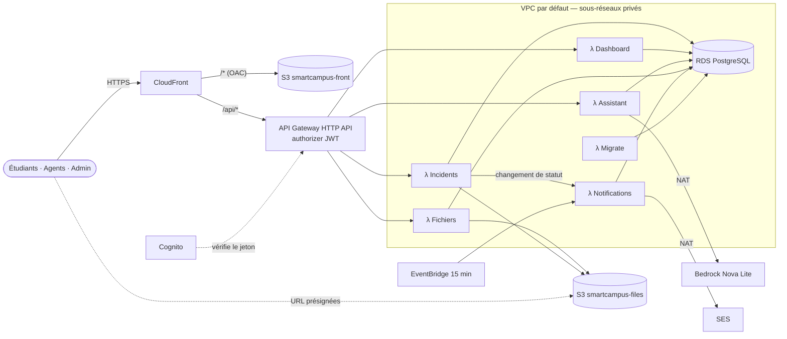

# Déploiement AWS — SmartCampus AI

Architecture validée avec les coachs, région **us-east-1**, compte du lab du workshop.
Tout est décrit dans [`template.yaml`](template.yaml) (AWS SAM). **Une commande déploie l'ensemble** : `npm run deploy:aws` (~15 min la première fois, surtout RDS et CloudFront). Chaque étape ci-dessous donne la partie SAM (ce que crée le template, la commande de vérification) et la marche à suivre dans la console si vous devez la refaire à la main.



Détail des flux, des préfixes par Lambda et des adapters : [docs/architecture.md](docs/architecture.md).

| | Valeur |
|---|---|
| Durée | ~20 min (dont ~15 min d'attente CloudFormation) |
| Coût | **≈ 1,70 $/jour**, **≈ 51 $/mois** si on oublie de supprimer (voir [Coûts](#coûts)) |
| Pile CloudFormation | `smartcampus` (variable `STACK_NAME` pour en changer) |
| Comptes de démo | alice.martin, bob.durand (étudiants), karim.benali, julie.robert (agents), claire.moreau (admin) `@esiea.fr`, mot de passe `Campus2026!` |

---

## Prérequis (sur votre poste)

| Outil | Vérification | Installation |
|---|---|---|
| Node.js 20.12+ | `node -v` | https://nodejs.org |
| AWS CLI v2 | `aws --version` | `brew install awscli` ou https://aws.amazon.com/cli/ |
| AWS SAM CLI | `sam --version` | `brew install aws-sam-cli` (si erreur `pyexpat` : `uv tool install aws-sam-cli --python 3.12`) |
| Dépendances | — | `npm install` à la racine du dépôt |

Docker n'est **pas** nécessaire pour déployer (seulement pour `sam local invoke`).

---

## 1. Se connecter

**Commande**
1. Page du lab → **Get AWS CLI credentials** (sur AWS Academy : *AWS Details* → *AWS CLI : Show*).
2. Copier le bloc `[default]` dans `~/.aws/credentials` (en remplaçant l'ancien), ou exporter les trois variables :
   ```bash
   export AWS_ACCESS_KEY_ID=ASIA...
   export AWS_SECRET_ACCESS_KEY=...
   export AWS_SESSION_TOKEN=...
   export AWS_REGION=us-east-1
   ```
3. Vérifier :
   ```bash
   aws sts get-caller-identity     # renvoie Account, UserId, Arn (…/voclabs/… ou …/LabRole/… sur un lab)
   ```

Les identifiants du lab **expirent** (au bout de quelques heures, ou à l'arrêt du lab) : en cas d'`ExpiredToken`, recommencez cette étape. Les scripts s'arrêtent avec un message clair et peuvent être relancés : ils reprennent là où ils en étaient.

**Console** : ouvrir la console depuis le bouton **AWS** du lab et vérifier la région **N. Virginia (us-east-1)** en haut à droite.

---

## Déployer en une commande

```bash
# Facultatif : emails réels via SES (sinon ils sont écrits dans les logs CloudWatch)
export SES_SENDER=votre.adresse@exemple.fr        # expéditeur, vérifié par SES
export SES_REDIRECT_TO=votre.adresse@exemple.fr   # sandbox : tous les emails de la démo arrivent ici

npm run deploy:aws
```

Ce que fait le script ([`scripts/aws/deploy.mjs`](scripts/aws/deploy.mjs)) :

1. `aws sts get-caller-identity` ;
2. choix des paramètres, mémorisés dans `.aws-deploy.json` (ignoré par git, contient les secrets générés) :
   - `LabRole` s'il existe, sinon la pile crée son rôle ;
   - VPC par défaut avec deux plages libres pour les sous-réseaux privés ;
   - mot de passe RDS et secret JWT aléatoires ;
   - envoi des emails de vérification SES si `SES_SENDER` est défini ;
3. build des Lambdas (`npm run build:lambda`, esbuild) et du front (`VITE_REALTIME_MODE=poll`) ;
4. `sam build` puis `sam deploy --resolve-s3 --capabilities CAPABILITY_IAM` ;
5. 2e `sam deploy` avec l'URL CloudFront (liens des emails, CORS du bucket fichiers) ;
6. Lambda Migrate : migrations, données de démo (si la base est vide), comptes Cognito ;
7. `aws s3 sync` du front + invalidation CloudFront `/*` ;
8. test de `https://<distribution>.cloudfront.net/api/health` et affichage de l'URL.

Autres commandes :

```bash
npm run migrate:aws              # ré-applique migrations + comptes Cognito (idempotent)
npm run migrate:aws -- --reset   # recharge les données de démo (efface les tickets créés pendant la démo)
npm run destroy:aws              # supprime tout (voir « Supprimer »)
```

Le détail ressource par ressource suit, dans l'ordre de création.

---

## 2. Ouvrir les flux (VPC, groupes de sécurité, NAT)

| Flux | Protocole / port | Source → destination | Porté par |
|---|---|---|---|
| Navigateur → CloudFront | HTTPS 443 | Internet → CloudFront | certificat CloudFront par défaut |
| CloudFront → S3 front | HTTPS | CloudFront → `smartcampus-front` | OAC (signature SigV4) |
| CloudFront → API Gateway | HTTPS 443 | CloudFront → `execute-api` | `/api/*`, en-tête `Authorization` transmis |
| Navigateur → S3 fichiers | HTTPS 443 | Internet → `smartcampus-files` | URL présignées (POST 10 Mo, GET 5 min), CORS = domaine CloudFront |
| Lambdas → RDS | TCP 5432 (TLS) | `sg-lambda` → `sg-rds` | seule règle entrante de `sg-rds` |
| Lambdas → S3 | HTTPS | sous-réseaux privés → endpoint passerelle S3 | gratuit, hors NAT |
| Lambdas → Bedrock, SES, Cognito, Lambda | HTTPS 443 | sous-réseaux privés → NAT Gateway → Internet | NAT dans un sous-réseau public |

| Groupe de sécurité | Entrant | Sortant |
|---|---|---|
| `smartcampus-sg-lambda` | **aucun** | tout |
| `smartcampus-sg-rds` | **5432/TCP depuis `smartcampus-sg-lambda`** | aucun |

**SAM** : ressources `PrivateSubnet1`, `PrivateSubnet2`, `NatEip`, `NatGateway`, `PrivateRouteTable` (0.0.0.0/0 → NAT), `S3GatewayEndpoint`, `LambdaSecurityGroup`, `RdsSecurityGroup` (`VpcMode=default`, ou `VPC_MODE=new` pour un VPC dédié 10.20.0.0/16).

```bash
aws ec2 describe-security-groups --filters Name=group-name,Values=smartcampus-sg-* \
  --query 'SecurityGroups[].{nom:GroupName,entrant:IpPermissions}'
aws ec2 describe-nat-gateways --filter Name=tag:Name,Values=smartcampus-nat --query 'NatGateways[].State'
```

**Console**
1. **VPC → Subnets → Create subnet** dans le VPC par défaut (172.31.0.0/16) : `smartcampus-private-1` en `172.31.255.0/24` (zone a), `smartcampus-private-2` en `172.31.254.0/24` (zone b).
2. **VPC → NAT gateways → Create** : sous-réseau **public** par défaut de la zone a, *Connectivity : Public*, **Allocate Elastic IP**.
3. **VPC → Route tables → Create** `smartcampus-private` : route `0.0.0.0/0` → la NAT ; *Subnet associations* : les deux sous-réseaux privés.
4. **VPC → Endpoints → Create** : service `com.amazonaws.us-east-1.s3`, type **Gateway**, table `smartcampus-private`.
5. **VPC → Security groups → Create** `smartcampus-sg-lambda` : aucune règle entrante.
6. **Create** `smartcampus-sg-rds` : entrant **PostgreSQL 5432**, source = le groupe `smartcampus-sg-lambda` (pas une IP) ; supprimer la règle sortante.

---

## 3. Créer le stockage (RDS et les deux buckets)

**SAM** : `DbSubnetGroup` et `Database` (PostgreSQL 16.15, db.t4g.micro, 20 Gio gp3, chiffré, non public, mono-AZ, sans sauvegarde : démo), `FrontBucket` + `FrontBucketPolicy` (lecture par cette distribution CloudFront uniquement), `FilesBucket` (CORS = domaine CloudFront) + `FilesBucketPolicy` (TLS obligatoire). Les deux buckets bloquent tout accès public et chiffrent en SSE-S3. Les noms sont suffixés par l'ID du compte (unicité mondiale) : `smartcampus-front-<compte>`, `smartcampus-files-<compte>`.

```bash
aws rds describe-db-instances --db-instance-identifier smartcampus-db \
  --query 'DBInstances[0].{etat:DBInstanceStatus,public:PubliclyAccessible,chiffre:StorageEncrypted}'
aws s3api get-public-access-block --bucket smartcampus-files-$(aws sts get-caller-identity --query Account --output text)
```

**Console**
1. **RDS → Subnet groups → Create** `smartcampus` : VPC par défaut, les deux sous-réseaux privés.
2. **RDS → Create database** :
   - *Standard create*, **PostgreSQL 16** ;
   - *Templates* : **Free tier** ou Dev/Test ; identifiant `smartcampus-db` ;
   - utilisateur `smartcampus`, mot de passe alphanumérique ;
   - **db.t4g.micro**, gp3 20 Gio, Single-AZ ;
   - *Public access* **No**, groupe `smartcampus-sg-rds`, subnet group `smartcampus` ;
   - *Additional configuration* : base initiale **`smartcampus`**, **Encryption** activé, sauvegardes 0 ou 1 jour, protection contre la suppression décochée.
3. **S3 → Create bucket** `smartcampus-front-<compte>` : *Block all public access* coché, SSE-S3. La politique de bucket est proposée par CloudFront à l'étape 4.
4. **S3 → Create bucket** `smartcampus-files-<compte>`, mêmes réglages. Puis **Permissions → CORS** :
   ```json
   [{ "AllowedOrigins": ["https://dxxxxxxxx.cloudfront.net"], "AllowedMethods": ["POST", "GET", "HEAD"], "AllowedHeaders": ["*"], "MaxAgeSeconds": 3000 }]
   ```

---

## 4. Créer les services

### Cognito
**SAM** : `UserPool` (création par l'admin uniquement, mot de passe 8 caractères avec majuscule, chiffre et symbole), `UserPoolClient` `smartcampus-web` (flux `USER_PASSWORD_AUTH` + `REFRESH_TOKEN_AUTH`, sans secret, jeton d'identité 60 min), groupes `STUDENT`, `AGENT`, `ADMIN`. La Lambda Migrate crée les 5 comptes de démo (mêmes emails, mot de passe `Campus2026!`, groupe = rôle). L'écran de connexion garde ses boutons de démo ; le SSO de l'école reste simulé.
```bash
aws cognito-idp list-users --user-pool-id <UserPoolId> --query 'Users[].Username'
```
**Console** : **Cognito → Create user pool**
1. Connexion par *email* ; MFA désactivé ; *Self-registration* désactivé.
2. App client *Public client* `smartcampus-web` : cocher **ALLOW_USER_PASSWORD_AUTH** et **ALLOW_REFRESH_TOKEN_AUTH**.
3. Onglet **Groups** : créer `STUDENT`, `AGENT` et `ADMIN`.
4. Les utilisateurs sont créés par la Lambda Migrate (plus bas).

### Lambdas (6 fonctions, Node 20, arm64)
**SAM** : un seul bundle `apps/api/dist/lambda` (~7 Mo par handler, Prisma 7 sans binaire natif : pas de `binaryTargets`). Les 6 fonctions sont dans les deux sous-réseaux privés, avec `smartcampus-sg-lambda`. Rôle : `LabRole` (paramètre `LabRoleArn`) ou `AppRole` créé par la pile.

| Fonction | Handler | Délai | Déclencheur |
|---|---|---|---|
| `smartcampus-incidents` | `http.handler` | 29 s | API (préfixes incidents, drafts, sla, users, notifications, audit, privacy, auth, health) |
| `smartcampus-dashboard` | `http.handler` | 29 s | API `/api/dashboard*` |
| `smartcampus-assistant` | `http.handler` | 29 s | API `/api/assistant*`, `/api/knowledge*` |
| `smartcampus-files` | `http.handler` | 29 s | API `/api/files*` |
| `smartcampus-notifications` | `notifications.handler` | 60 s | EventBridge + invocation par Incidents |
| `smartcampus-migrate` | `migrate.handler` | 300 s | manuel (`npm run migrate:aws`) |

```bash
aws lambda list-functions --query "Functions[?starts_with(FunctionName,'smartcampus-')].[FunctionName,Runtime,State]" --output table
aws logs tail /aws/lambda/smartcampus-incidents --since 10m --follow
```
**Console**
1. `npm run build:lambda`, puis `cd apps/api/dist/lambda && zip -r ../lambda.zip .`
2. **Lambda → Create function** (×6) :
   - *Author from scratch*, **Node.js 20.x**, **arm64** ;
   - *Execution role* : **LabRole** ;
   - *Advanced* → **Enable VPC** : VPC par défaut, deux sous-réseaux privés, groupe `smartcampus-sg-lambda` ;
   - téléverser `lambda.zip`, renseigner le *Handler* du tableau, et dans *Configuration → General* : mémoire **1024 Mo** et le délai du tableau.
3. *Configuration → Environment variables* (toutes les fonctions) :

| Variable | Valeur |
|---|---|
| `NODE_ENV` | `production` |
| `DATABASE_URL` | `postgresql://smartcampus:<mdp>@<endpoint RDS>:5432/smartcampus?sslmode=verify-full` |
| `NODE_EXTRA_CA_CERTS` | `/var/runtime/ca-cert.pem` (autorités RDS fournies par le runtime) |
| `JWT_SECRET` | `openssl rand -base64 48` |
| `AUTH_PROVIDER` · `COGNITO_USER_POOL_ID` · `COGNITO_CLIENT_ID` | `cognito` · ID du pool · ID du client |
| `STORAGE_DRIVER` · `S3_BUCKET` | `s3` · `smartcampus-files-<compte>` |
| `MAIL_DRIVER` | `lambda` sur Incidents (+ `NOTIFICATIONS_FUNCTION=smartcampus-notifications`), `ses` ailleurs (ou `console` sans SES) |
| `MAIL_FROM` · `MAIL_REDIRECT_TO` | `SmartCampus <expéditeur vérifié>` · adresse vérifiée (sandbox) |
| `APP_URL` | `https://dxxxxxxxx.cloudfront.net` |
| `REALTIME_MODE` · `AI_DRIVER` · `BEDROCK_MODEL_ID` | `poll` · `bedrock` · `us.amazon.nova-lite-v1:0` |
| `DEMO_MODE` · `DEMO_PASSWORD` · `COOKIE_SECURE` | `true` · `Campus2026!` · `true` |
| `MAIL_OUTBOX_DIR` · `UPLOAD_DIR` | `/tmp/outbox` · `/tmp/uploads` |

4. **Migrate** : onglet *Test*, événement `{}`, **Test**. Résultat attendu : `{"migrations":[…],"seeded":true,"cognitoUsers":5}`. Le migrateur applique `prisma/migrations` dans la même table `_prisma_migrations` que `prisma migrate deploy` (le moteur natif de Prisma n'est pas embarqué).

### API Gateway (HTTP API + authorizer JWT Cognito)
**SAM** : `HttpApi` avec l'authorizer `CognitoJwt` par défaut :
- émetteur `https://cognito-idp.us-east-1.amazonaws.com/<UserPoolId>`, audience = ID du client ;
- routes publiques (authorizer `NONE`) : `GET /api/health`, `POST /api/auth/login|refresh|logout`, `GET /api/auth/demo-accounts` ;
- routes protégées : `ANY /api/<préfixe>` et `ANY /api/<préfixe>/{proxy+}` vers la Lambda du préfixe.
```bash
aws apigatewayv2 get-routes --api-id <id> --query 'Items[].[RouteKey,AuthorizationType]' --output table
```
**Console** : **API Gateway → Create API → HTTP API**
1. Intégrations : les 4 Lambdas HTTP.
2. Routes : celles du tableau des Lambdas, chacune en `ANY /api/x` et `ANY /api/x/{proxy+}`.
3. **Authorization → Create JWT authorizer** :
   - *Identity source* `$request.header.Authorization` ;
   - émetteur et audience comme ci-dessus ;
   - à attacher à toutes les routes sauf les 5 routes publiques.
4. Stage `$default`, *auto-deploy*.

### EventBridge
**SAM** : règle `smartcampus-overdue-check`, `rate(15 minutes)` → `smartcampus-notifications` (US-18 : tickets NOUVEAU au-delà du délai cible). Elle remplace le minuteur interne du serveur local.
```bash
aws events describe-rule --name smartcampus-overdue-check --query '{etat:State,frequence:ScheduleExpression}'
```
**Console** : **EventBridge → Rules → Create rule** → *Schedule* → `rate(15 minutes)` → cible : Lambda `smartcampus-notifications`.

### Bedrock (Nova Lite)
**SAM** : rien à créer. Les Lambdas appellent `bedrock-runtime` (Converse, `us.amazon.nova-lite-v1:0`) via la NAT. Délai de 15 s ; en cas d'échec (modèle non activé, lab restreint, pas de NAT), **repli automatique sur l'assistant mock**, écrit dans les logs : la démo continue.
```bash
aws bedrock-runtime converse --model-id us.amazon.nova-lite-v1:0 --messages '[{"role":"user","content":[{"text":"Bonjour"}]}]' --query 'output.message.content[0].text'
```
**Console** : **Bedrock → Model catalog → Amazon Nova Lite** : vérifier qu'il est utilisable. Sinon, demander l'accès dans *Model access* (immédiat pour Nova).

### SES (emails, US-10)
**SAM** : pas de ressource. `SES_SENDER` devient `MAIL_FROM`. Le script lance la vérification des adresses (`aws sesv2 create-email-identity`). En **sandbox**, l'expéditeur **et** chaque destinataire doivent être vérifiés. Les adresses `@esiea.fr` des comptes de démo n'existent pas, d'où `SES_REDIRECT_TO` : tous les emails partent vers cette adresse, avec le destinataire réel dans l'objet.

**Adresses à vérifier** : l'expéditeur (`SES_SENDER`) et l'adresse de redirection (`SES_REDIRECT_TO`). Une seule adresse d'équipe peut servir aux deux.
```bash
aws sesv2 get-email-identity --email-identity votre.adresse@exemple.fr --query VerifiedForSendingStatus
```
**Console** : **SES → Identities → Create identity → Email address**, puis cliquer sur le lien reçu. Sans SES, les emails apparaissent dans les logs de `smartcampus-notifications`.

### CloudFront
**SAM** : `Distribution` avec le certificat par défaut, sans domaine personnalisé ni Traefik.
- **Origine par défaut** : S3 front via `FrontOac`. Cache `CachingOptimized` et en-têtes de sécurité (`SecurityHeadersPolicy`). `index.html` est envoyé en `no-cache`.
- **`/api/*`** : vers API Gateway, toutes méthodes. Cache `smartcampus-api` (TTL 0, `Authorization` transmis), `AllViewerExceptHostHeader`.
- **Routes de l'application** : la CloudFront Function `smartcampus-spa-rewrite` renvoie `/index.html` pour tout chemin sans extension (rechargement, lien direct).

  Écart volontaire : la demande prévoyait de passer par les réponses d'erreur 403/404 de CloudFront. Celles-ci s'appliquent aussi à `/api/*` : elles remplaceraient les erreurs JSON de l'API (403 accès refusé, 404 ticket d'un autre étudiant) par la page HTML.
```bash
aws cloudfront get-distribution --id <DistributionId> --query 'Distribution.{etat:Status,domaine:DomainName}'
```
**Console** : **CloudFront → Create distribution**
1. Origine `smartcampus-front-<compte>`, *Origin access* : **Origin access control** (créer), puis appliquer la politique de bucket proposée.
2. *Default root object* `index.html`, *Redirect HTTP to HTTPS*.
3. **Add origin** : `<api-id>.execute-api.us-east-1.amazonaws.com`, HTTPS only.
4. **Add behavior** `/api/*` vers cette origine :
   - méthodes GET, HEAD, OPTIONS, PUT, POST, PATCH, DELETE ;
   - *Cache policy* personnalisée : TTL 0/0/1, en-tête `Authorization`, toutes les query strings ;
   - *Origin request policy* `AllViewerExceptHostHeader`.
5. **Functions → Create** `smartcampus-spa-rewrite` (code dans `template.yaml`), *Publish*, puis l'associer en *Viewer request* au comportement par défaut.
6. Front :
   ```bash
   VITE_REALTIME_MODE=poll npm run build
   aws s3 sync apps/web/dist s3://smartcampus-front-<compte> --delete
   aws cloudfront create-invalidation --distribution-id <id> --paths "/*"
   ```

---

## 5. Tester

URL : affichée à la fin de `npm run deploy:aws` (sortie `AppUrl`), ou :
```bash
aws cloudformation describe-stacks --stack-name smartcampus --query "Stacks[0].Outputs[?OutputKey=='AppUrl'].OutputValue" --output text
curl -s https://dxxxxxxxx.cloudfront.net/api/health   # "status":"ok", "auth":"cognito", "storage":"s3", "realtime":"poll"
```

**Parcours 1 — Étudiant** (`alice.martin@esiea.fr`, sur téléphone ou en largeur mobile)
- [ ] Connexion par le bouton de démo ; rechargement d'une page interne (F5) sans erreur.
- [ ] Signalement **avec photo** (ou PDF), envoyé directement à S3 ; numéro `SC-xxxx` affiché.
- [ ] La photo s'affiche dans le détail du ticket (URL `smartcampus-files-…amazonaws.com`, valable 5 min).
- [ ] Ticket Sécurité → priorité **Critique**.

**Parcours 2 — Agent** (`karim.benali@esiea.fr`)
- [ ] Le nouveau ticket apparaît dans la file en moins de 20 s (polling).
- [ ] Prise en charge, puis Résolu avec commentaire ; la suggestion de qualification IA s'affiche (US-25).
- [ ] Email « statut changé » reçu sur `SES_REDIRECT_TO`, ou visible dans `aws logs tail /aws/lambda/smartcampus-notifications`.

**Parcours 3 — Administration** (`claire.moreau@esiea.fr`)
- [ ] Bandeau d'alerte du ticket critique ; tableau de bord rempli, avec filtres.
- [ ] Export CSV téléchargé ; changement de rôle d'un utilisateur ; journal d'audit.
- [ ] Délais cibles modifiables ; un ticket en retard est signalé au plus tard 15 min après (EventBridge).

**Parcours 4 — Assistant IA** (`bob.durand@esiea.fr`)
- [ ] « Le wifi ne marche pas, je fais quoi ? » → réponse avec source FAQ.
- [ ] Pas de « repli sur mock » dans `aws logs tail /aws/lambda/smartcampus-assistant` (sinon, voir Dépannage).
- [ ] « Fais mon devoir de maths » → refus poli (hors périmètre campus).

---

## Coûts

us-east-1, tarifs à la demande, indicatifs. La NAT Gateway représente l'essentiel de la facture.

| Service | Configuration | Par jour | Par mois (730 h) |
|---|---|---|---|
| NAT Gateway | 1 NAT, ~0,045 $/h + 0,045 $/Go traité | ~1,08 $ | ~33 $ |
| IPv4 publique | IP élastique de la NAT, 0,005 $/h | ~0,12 $ | ~3,65 $ |
| RDS PostgreSQL | db.t4g.micro, ~0,016 $/h | ~0,38 $ | ~11,70 $ |
| Stockage RDS | 20 Gio gp3 | ~0,08 $ | ~2,30 $ |
| Lambda, API Gateway, EventBridge | trafic de démo | < 0,01 $ | < 0,50 $ |
| CloudFront, S3, Cognito, CloudWatch Logs | offre gratuite / volume minime | < 0,01 $ | < 0,50 $ |
| Bedrock Nova Lite | ~200 questions | < 0,05 $ | à l'usage |
| SES | quelques dizaines d'emails | < 0,01 $ | à l'usage |
| **Total** | | **≈ 1,70 $** | **≈ 51 $** |

L'offre gratuite peut couvrir RDS et Lambda sur un compte récent. Le budget du lab est souvent plafonné : **supprimez la pile après la démo**.

---

## Supprimer

```bash
npm run destroy:aws      # demande « oui » ; -- --yes pour ne pas demander
```

Ordre suivi par le script et par CloudFormation, à reproduire tel quel dans la console :

1. **Vider les buckets** `smartcampus-front-<compte>` et `smartcampus-files-<compte>` (S3 → *Empty*) : un bucket non vide bloque la suppression.
2. **CloudFront** : *Disable*, attendre *Deployed*, puis *Delete* la distribution, la fonction `smartcampus-spa-rewrite`, l'OAC et la politique de cache.
3. **API Gateway** : supprimer l'API HTTP.
4. **EventBridge** : supprimer la règle `smartcampus-overdue-check`.
5. **Lambda** : supprimer les 6 fonctions (leurs interfaces réseau dans le VPC sont libérées en 5 à 20 min).
6. **RDS** : *Delete* `smartcampus-db`, sans instantané final ; puis le subnet group.
7. **Cognito** : supprimer le user pool.
8. **Réseau** : NAT Gateway, puis *Release* de l'IP élastique (sinon elle reste facturée), puis endpoint S3, table de routage, sous-réseaux privés, groupes de sécurité (`sg-rds` avant `sg-lambda`).
9. **Buckets** : *Delete* ; **IAM** : `AppRole` s'il a été créé.
10. Hors pile, à supprimer si besoin : identités SES vérifiées, pile `aws-sam-cli-managed-default` (bucket d'artefacts SAM, vide après `sam delete`).

Le lendemain, **Billing → Bills** : plus aucun service actif.

---

## Dépannage

| Symptôme | Cause | Solution |
|---|---|---|
| `ExpiredToken` / « security token … expired » | Identifiants du lab expirés | Étape 1 : « Get AWS CLI credentials », remplacer `~/.aws/credentials`, relancer la même commande (elle reprend) |
| `CREATE_FAILED AppRole` · `iam:CreateRole … not authorized` | Création de rôles interdite sur le lab | `LAB_ROLE_ARN=$(aws iam get-role --role-name LabRole --query Role.Arn --output text) npm run deploy:aws`. Si la pile est en `ROLLBACK_COMPLETE` : `npm run destroy:aws` d'abord |
| Assistant toujours en « mock », logs : `connect ETIMEDOUT` vers `bedrock-runtime` | Lambda sans accès Internet : NAT absente, en échec, ou route `0.0.0.0/0` manquante sur la table privée | `aws ec2 describe-nat-gateways` (état `available`), route vers la NAT et sous-réseaux associés. `AccessDeniedException` : activer Nova Lite (Bedrock → Model access) ou garder le mock |
| 403 ou `AccessDenied` (XML) en rechargeant une page | Fonction `smartcampus-spa-rewrite` non associée, ou fichier absent de S3 | Comportement par défaut → *Function associations* → *Viewer request*. Vérifier `aws s3 ls s3://smartcampus-front-<compte>/index.html`, puis invalider `/*` |
| Pas d'email reçu ; logs : `MessageRejected: Email address is not verified` | SES en sandbox | Vérifier l'expéditeur **et** `SES_REDIRECT_TO` (lien reçu par email), puis `SES_REDIRECT_TO=… npm run deploy:aws`. Sans SES, lire les emails dans `aws logs tail /aws/lambda/smartcampus-notifications` |
| `Task timed out after 29 s` / 503, logs bloqués sur la connexion à la base | Lambda → RDS filtré | `sg-rds` doit autoriser 5432 depuis **le groupe** `sg-lambda` (pas une IP) ; Lambdas dans les sous-réseaux privés du même VPC que RDS ; RDS à l'état `available` |
| `self-signed certificate in certificate chain` vers RDS | `NODE_EXTRA_CA_CERTS` absent | `NODE_EXTRA_CA_CERTS=/var/runtime/ca-cert.pem` (déjà dans le template) |
| 401 sur toutes les requêtes après connexion | Authorizer : émetteur ou audience faux, ou en-tête `Authorization` non transmis par CloudFront | Émetteur `https://cognito-idp.us-east-1.amazonaws.com/<pool>`, audience = ID du client ; politique de cache `/api/*` incluant `Authorization` |
| Envoi de photo refusé (CORS) dans la console du navigateur | CORS du bucket fichiers ≠ domaine CloudFront | Relancer `npm run deploy:aws` (2e passage `AppUrl`) ou corriger le CORS (étape 3) |

---

## Annexe — Plan B : une instance EC2 avec Docker Compose

À utiliser si le lab bloque Lambda, API Gateway, Cognito ou CloudFront. Même code, adapters locaux (cookie, SSE) : `AUTH_PROVIDER=local`, `REALTIME_MODE=sse`. Durée : ~45 min.

```
Internet ─HTTPS─▶ EC2 t3.small (Traefik + Let's Encrypt, domaine <ip>.sslip.io)
                    ├─ /api/* ─▶ api (Node, Express, Prisma) ──5432──▶ RDS (sg-rds ← sg-ec2)
                    └─ /      ─▶ web (nginx, build Vite)       └─ rôle IAM ─▶ S3, Bedrock, SES
```

1. **Groupes de sécurité** : `sg-smartcampus-ec2` (entrant 80 et 443 depuis 0.0.0.0/0, 22 depuis *My IP*), `sg-smartcampus-rds` (5432 depuis `sg-smartcampus-ec2`).
2. **RDS** comme à l'étape 3, avec le groupe `sg-smartcampus-rds`.
3. **Bucket** `smartcampus-files-<compte>` (étape 3). CORS : `AllowedOrigins` = `https://<ip-avec-tirets>.sslip.io`, nécessaire pour l'envoi direct des photos.
4. **EC2** :
   - *Launch instance* : Amazon Linux 2023, **t3.small**, 20 Gio gp3 chiffré, groupe `sg-smartcampus-ec2` ;
   - profil **`LabInstanceProfile`** (ou un rôle autorisant `s3:GetObject/PutObject/DeleteObject` sur le bucket, `bedrock:InvokeModel` et `ses:SendEmail`) ;
   - *User data* :
   ```bash
   #!/bin/bash
   dnf install -y docker git
   systemctl enable --now docker
   usermod -aG docker ec2-user
   mkdir -p /usr/local/lib/docker/cli-plugins
   curl -fsSL "https://github.com/docker/compose/releases/download/v2.29.7/docker-compose-linux-x86_64" -o /usr/local/lib/docker/cli-plugins/docker-compose
   curl -fsSL "https://github.com/docker/buildx/releases/download/v0.17.1/buildx-v0.17.1.linux-amd64" -o /usr/local/lib/docker/cli-plugins/docker-buildx
   chmod +x /usr/local/lib/docker/cli-plugins/docker-*
   ```
5. **IP élastique** associée à l'instance. Domaine : `3.91.12.34` → `3-91-12-34.sslip.io`.
6. **Déployer** :
   ```bash
   ssh -i ma-cle.pem ec2-user@<ip>
   git clone https://github.com/YACINE-CODE16/smartcampus-ai.git && cd smartcampus-ai
   cp .env.prod.example .env.prod && nano .env.prod   # DOMAIN, ACME_EMAIL, DATABASE_URL (?sslmode=no-verify), JWT_SECRET, S3_BUCKET, AI_DRIVER
   docker compose -f docker-compose.prod.yml --env-file .env.prod up -d --build
   docker compose -f docker-compose.prod.yml --env-file .env.prod exec api npm run seed
   ```
7. **Tester** : `https://<domaine>/api/health`, puis les 4 parcours ci-dessus (le temps réel passe par SSE).
8. **Coût** : ≈ 1,50 $/jour (EC2 t3.small ~0,50 $, RDS ~0,45 $, IP ~0,12 $, EBS ~0,05 $), sans NAT.
9. **Supprimer** :
   - *Terminate* l'instance, puis *Release* l'IP élastique ;
   - RDS sans instantané ;
   - vider puis supprimer le bucket ;
   - groupes de sécurité (`sg-rds` d'abord), paire de clés.

Test de cette pile sur son poste :
```bash
docker compose -p smartcampus-prodtest -f docker-compose.prod.yml -f docker-compose.local-test.yml --env-file .env.local-test up -d --build
# → http://localhost:8080 ; arrêt : … down -v
```
