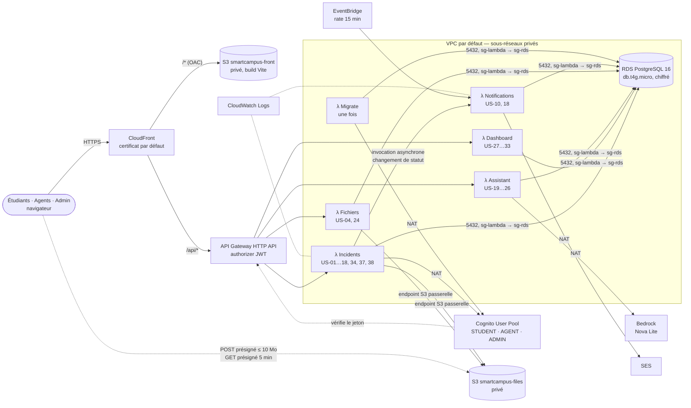

# Architecture SmartCampus AI

Architecture validée avec les coachs (workshop Capgemini × ESIEA), déployée par `template.yaml` (AWS SAM) en région **us-east-1**.

## Parcours d'une requête

1. Le navigateur charge le front depuis CloudFront ; le bucket `smartcampus-front` est privé et lisible uniquement par cette distribution (Origin Access Control). Une CloudFront Function renvoie `/index.html` pour les routes de l'application (rechargement, lien direct).
2. Connexion : l'écran « Connexion école » (boutons de démo conservés) appelle `POST /api/auth/login`, qui ouvre la session Cognito (flux `USER_PASSWORD_AUTH`) et renvoie les jetons. Le SSO de l'école reste simulé.
3. Chaque appel `/api/*` porte `Authorization: Bearer <idToken>`. CloudFront le transmet sans cache. L'authorizer JWT d'API Gateway vérifie la signature, l'émetteur, l'audience et l'expiration, puis la Lambda relit l'utilisateur et son rôle en base (le rôle de référence est en base, synchronisé vers les groupes Cognito).
4. API Gateway route selon le préfixe : un seul bundle Express (`http.mjs`) est déployé en 4 Lambdas.

| Lambda | Préfixes | User stories |
|---|---|---|
| Incidents | `/api/incidents*`, `/api/drafts*`, `/api/sla*`, `/api/users*`, `/api/notifications*`, `/api/audit*`, `/api/privacy*`, `/api/auth*`, `/api/health` | US-01 à US-18, US-34, US-37, US-38 |
| Dashboard | `/api/dashboard*` | US-27 à US-33 |
| Assistant | `/api/assistant*`, `/api/knowledge*` | US-19 à US-26 |
| Fichiers | `/api/files*` | US-04, US-24 |
| Notifications | EventBridge `rate(15 minutes)` + invocation par Incidents | US-10, US-18 |
| Migrate | invoquée par `npm run migrate:aws` | migrations, démo, comptes Cognito |

## Pièces jointes (US-04)

API Gateway limite les requêtes à 10 Mo : le fichier ne transite pas par l'API.

1. `POST /api/files/uploads {contentType, size}` → la Lambda Fichiers renvoie un POST présigné S3 (type imposé, 10 Mo maximum, 5 minutes).
2. Le navigateur envoie le fichier directement au bucket `smartcampus-files` (CORS limité au domaine CloudFront).
3. `POST /api/incidents {…, attachmentKey}` → l'API vérifie que l'objet existe, sa taille et sa signature binaire (JPG, PNG, PDF), et qu'il n'est pas déjà rattaché.
4. Lecture : `GET /api/files/incidents/:id` renvoie une URL présignée de 5 minutes, seulement si l'utilisateur a le droit de voir le ticket.

## Choix d'adapters par environnement

Le code métier ne change pas : `src/container.ts` choisit les implémentations des ports selon les variables d'environnement.

| Port | Local (`npm run dev`) | AWS |
|---|---|---|
| Authentification | comptes en base, cookie JWT httpOnly | Cognito + authorizer JWT (`AUTH_PROVIDER=cognito`) |
| Fichiers | disque, jetons signés imitant les URL présignées | S3 présigné (`STORAGE_DRIVER=s3`) |
| Emails | console + fichiers `.eml` | Incidents → Lambda Notifications → SES (`MAIL_DRIVER=lambda` puis `ses`) |
| Temps réel | SSE (`/api/events`) | polling 20 s (`VITE_REALTIME_MODE=poll`) |
| Délais (US-18) | minuteur dans le serveur | EventBridge → Lambda Notifications |
| IA | mock | Bedrock Nova Lite, repli automatique sur le mock |
| Migrations | `prisma migrate dev` | Lambda Migrate (même table `_prisma_migrations`) |

## Réseau et sécurité

| Groupe de sécurité | Entrée | Sortie |
|---|---|---|
| `sg-lambda` | aucune | tout (NAT, endpoint S3, RDS) |
| `sg-rds` | 5432/TCP depuis `sg-lambda` uniquement | aucune |

- Lambdas et RDS dans deux sous-réseaux privés du VPC par défaut, sans IP publique ; RDS chiffré, non public, TLS vérifié (`sslmode=verify-full`).
- NAT Gateway (sous-réseau public) pour Bedrock, SES, Cognito et l'invocation Lambda ; endpoint passerelle S3 gratuit pour le trafic vers les buckets.
- Buckets privés (Block Public Access, chiffrement SSE-S3) ; le bucket fichiers refuse tout accès hors TLS.
- Secrets (mot de passe RDS, secret JWT) générés par le script de déploiement, stockés dans `.aws-deploy.json` (ignoré par git) et passés en paramètres `NoEcho`.
